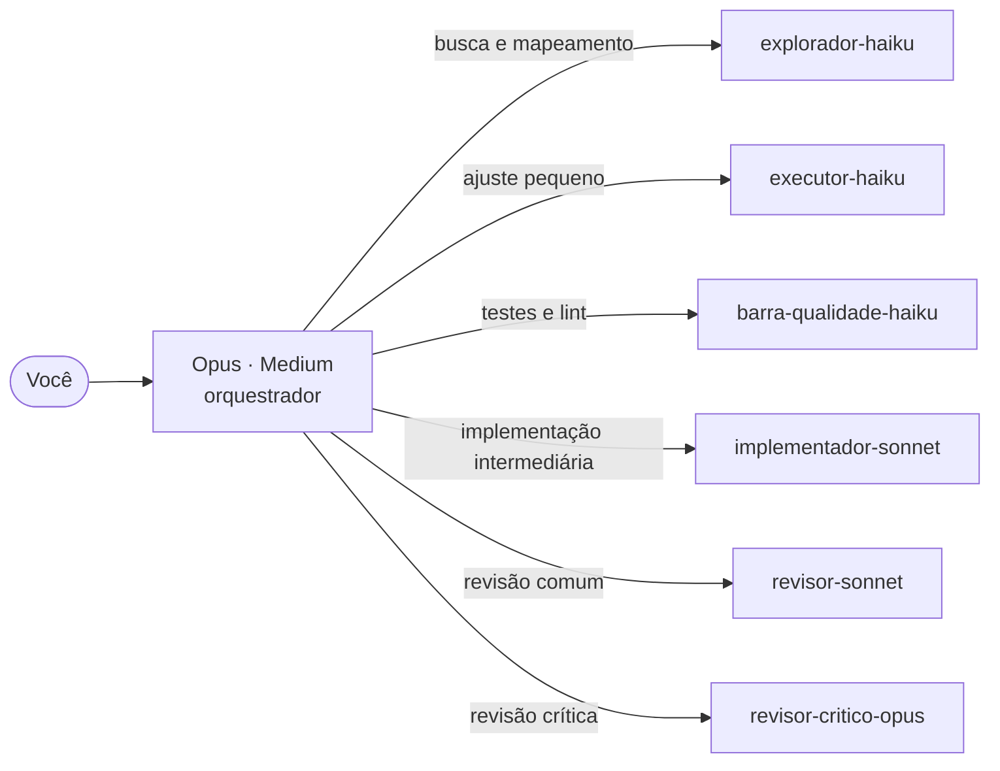

<div align="center">

# 🎛️ claude-orquestrador

**O Opus coordena. Haiku e Sonnet executam. Você gasta menos limite sem perder qualidade.**

Pacote de configuração para o [Claude Code](https://code.claude.com) que transforma o Opus em orquestrador:
ele mantém arquitetura, segurança e qualidade sob controle e delega busca, testes e
implementações simples a modelos mais leves.


</div>

---

## ✨ Por que usar

- **Economia de limite** — buscas em muitos arquivos e execução de testes vão para o Haiku, que consome bem menos que o Opus.
- **Sempre na versão mais nova** — modelos por atalho (`opus`, `sonnet`, `haiku`): quando sai uma versão nova, o pacote acompanha sozinho.
- **Esforço fixo em Medium** — configurado de forma geral, vale para qualquer versão do Opus.
- **Delegação com bom senso** — tarefas simples o Opus resolve direto; subagentes só quando compensam.
- **Guarda-corpos** — pede aprovação antes de deploy, push, migrações e exclusões; nunca expõe segredos; não inventa resultados de testes.
- **Instalação não destrutiva** — faz backup e mescla com suas configurações, sem apagar hooks, plugins ou instruções existentes.

## 🧭 Como funciona



| Agente | Modelo | Esforço | Papel | Escreve arquivos? |
|---|---|---|---|---|
| `explorador-haiku` | Haiku | Low | Localiza arquivos, funções e dependências | Não |
| `executor-haiku` | Haiku | Medium | Alterações pequenas, delimitadas e de baixo risco | Sim |
| `barra-qualidade-haiku` | Haiku | Low | Roda testes e checagens existentes | Não |
| `implementador-sonnet` | Sonnet | Medium | Implementações de complexidade intermediária | Sim |
| `revisor-sonnet` | Sonnet | Medium | Revisão de diffs de risco comum | Não |
| `revisor-critico-opus` | Opus | Medium | Segurança, dados, autorização, migrações | Não |

**Regras de operação:** no máximo 2 subagentes simultâneos, só para trabalhos independentes; nunca dois escritores no mesmo arquivo; no máximo duas tentativas automáticas de correção antes de reportar o bloqueio.

### Skills incluídas

| Skill | Uso |
|---|---|
| `/orquestrar <tarefa>` | Coordenação explícita de uma tarefa com delegação |
| `/verificar <escopo>` | Verificação proporcional ao risco: PASSOU / FALHOU / NÃO EXECUTADO |
| `/compactar-com-contexto` | Resumo de decisões e estado antes de compactar a conversa |
| `/evoluir-skills <observação>` | Propõe melhorias nos agentes e skills — nunca aplica sem aprovação |

> Você **não precisa** começar toda tarefa com `/orquestrar`: as regras do `CLAUDE.md` já orientam a delegação. A skill serve para quando quiser coordenação explícita.

## 🚀 Instalação

**Requisitos:** Windows 10/11 · [PowerShell 7+](https://learn.microsoft.com/powershell/scripting/install/installing-powershell-on-windows) · Claude Code atualizado (`claude update`) · acesso aos modelos Opus, Sonnet e Haiku pelo seu plano.

```powershell
git clone https://github.com/SharkSource/claude-orquestrador.git
cd claude-orquestrador
```

**Global** (vale para todos os projetos):

```powershell
pwsh -NoProfile -ExecutionPolicy Bypass -File .\INSTALAR.ps1 -Escopo Global
```

**Em um projeto específico:**

```powershell
pwsh -NoProfile -ExecutionPolicy Bypass -File .\INSTALAR.ps1 -Escopo Projeto -Destino 'C:\caminho\do\projeto'
```

> Revise o `INSTALAR.ps1` antes de executar — é curto e comentado.

Depois, abra uma nova sessão do Claude Code e confira com `/model`, `/effort`, `/agents` e `/skills`.

### Para atualizar

```powershell
git pull
pwsh -NoProfile -ExecutionPolicy Bypass -File .\INSTALAR.ps1 -Escopo Global
```

## 🔧 O que o instalador altera

| Arquivo | Alteração |
|---|---|
| `settings.json` | Define `"model": "opus"` e `"effortLevel": "medium"`. Remove esforços fixados por versão do Opus deixados por pacotes antigos. **Todo o resto é preservado.** |
| `CLAUDE.md` | Insere (ou atualiza) só o bloco entre `<!-- BEGIN ORQUESTRADOR-OPUS-MEDIUM -->` e `<!-- END ... -->`. O restante do arquivo fica intacto. |
| `agents/` e `skills/` | Cria os arquivos que não existem. Atualiza só os que estão idênticos à versão 1 do pacote; os que você personalizou são preservados com aviso. |

Antes de alterar `settings.json` ou `CLAUDE.md`, o instalador cria cópias `.backup-AAAAMMDD-HHMMSS-fff` ao lado do original.

### Verificação rigorosa (opcional)

```powershell
pwsh -NoProfile -ExecutionPolicy Bypass -File .\INSTALAR.ps1 -Escopo Global -VerificacaoRigorosa
```

Adiciona um hook que chama o Haiku ao fim de cada resposta para checar se alguma verificação viável foi omitida. **Aumenta consumo e latência** — comece sem ele.

## 🗑️ Desinstalação

1. Apague os 6 arquivos de `agents/` e as 4 pastas de `skills/` listadas acima.
2. Remova o bloco `ORQUESTRADOR-OPUS-MEDIUM` do `CLAUDE.md`.
3. Se quiser, restaure o `settings.json` a partir do backup `.backup-*`.

## ⚠️ Avisos honestos

- **Não há economia garantida.** Subagentes começam sem o contexto da conversa e podem repetir leituras; em tarefas pequenas, delegar pode sair mais caro. As regras mandam o Opus resolver direto nesses casos.
- O limite de 2 subagentes simultâneos é uma **orientação** no `CLAUDE.md`, não uma trava da ferramenta.
- O bloco de regras fica sempre carregado: cerca de 650 palavras em todo contexto onde o pacote estiver instalado.
- `.env` **não é bloqueado**: as regras permitem lê-lo quando a tarefa exigir, mas proíbem expor valores de segredos.
- Políticas de organização, variáveis como `ANTHROPIC_MODEL` e parâmetros de sessão podem prevalecer sobre estes arquivos.
- Projeto independente — **não é oficial da Anthropic**.

## 📁 Estrutura

```
claude-orquestrador/
├── .claude/
│   ├── agents/                  # 6 subagentes
│   ├── skills/                  # 4 skills
│   └── settings.json            # modelo + esforço
├── CLAUDE.md                    # regras de orquestração (bloco com marcadores)
├── INSTALAR.ps1                 # instalador / atualizador
├── PERFIL_VERIFICACAO_INTENSA.json   # hook opcional
└── MANIFESTO-V1.json            # hashes da v1, para atualização segura
```

## 📚 Referências

Documentação oficial do Claude Code: [modelos](https://code.claude.com/docs/en/model-config) · [configurações](https://code.claude.com/docs/en/settings) · [subagentes](https://code.claude.com/docs/en/sub-agents) · [skills](https://code.claude.com/docs/en/skills) · [hooks](https://code.claude.com/docs/en/hooks)

## 📄 Licença

[MIT](LICENSE) — use, modifique e distribua à vontade.
